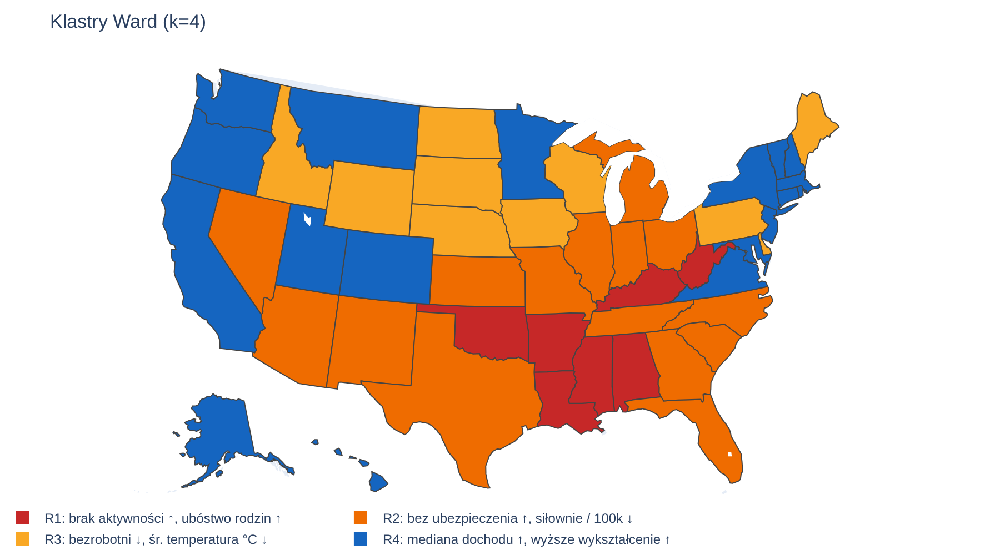
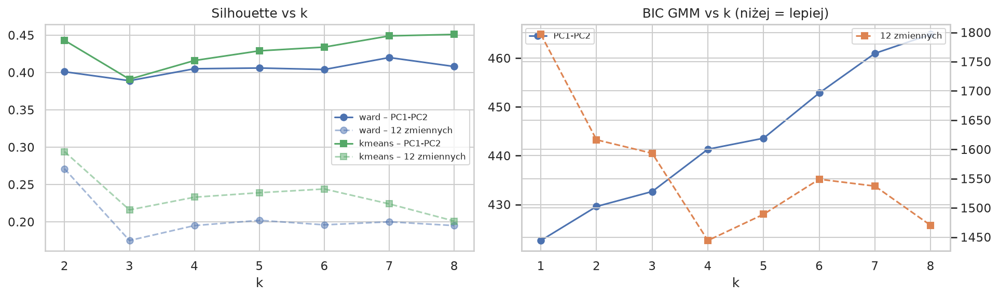

# US State Health Clustering

Exploratory analysis and clustering of the 50 US states by public health and socio-economic indicators (2013–2023), built from four public data sources: CDC BRFSS, Census ACS, Census CBP and NOAA.

## Key findings

- **One dominant axis.** PCA on 12 state-level indicators: PC1 explains 54% of the variance. PC1 contrasts education, income and working from home with obesity, physical inactivity, poverty and car commuting. Across states, obesity correlates with driving to work (Spearman ρ = 0.87), physical inactivity (0.76) and bachelor's degree attainment (−0.75).
- **Obesity rose in every region** between 2013 and 2023: by 3.5 pp in the Northeast and 6.0 pp in the Midwest. The gap between the South and the rest did not narrow.
- **One robust cluster.** Seven states (AL, AR, KY, LA, MS, OK, WV) form the same high-risk cluster under both Ward and K-Means. They stay together in 99% of bootstrap re-runs.
- **The remaining structure is closer to a gradient than to well-separated groups.**
  - Ward (k=4) has a silhouette of 0.41 in the PC1–PC2 plane but only 0.19 in the full 12-feature space.
  - GMM BIC in the 2D plane is lowest for k=1.
  - Bootstrap agreement with the full-sample solution has a median ARI of about 0.6.
- **Remote work changed meaning after COVID.** Its correlation with education rose from 0.55 (2018–19) to 0.82 (2021–23), while its correlation with high physical activity fell from 0.63 to 0.35.

Main result (Ward, k=4), clusters ordered by health risk:

| Cluster | States | Profile |
|---|---|---|
| R1 (7) | AL, AR, KY, LA, MS, OK, WV | highest obesity, inactivity and family poverty; lowest income and education |
| R2 (15) | AZ, FL, GA, IL, IN, KS, MI, MO, NV, NM, NC, OH, SC, TN, TX | above-average risk, highest uninsured share, few gyms per capita |
| R3 (10) | DE, ID, IA, ME, NE, ND, PA, SD, WI, WY | average health, lowest unemployment, cold climate |
| R4 (18) | AK, CA, CO, CT, HI, MD, MA, MN, MT, NH, NJ, NY, OR, RI, UT, VT, VA, WA | highest income and education, most active, lowest obesity |



## Data

| Source | Variables | Years |
|---|---|---|
| [CDC BRFSS](https://data.cdc.gov/d/hn4x-zwk7) | obesity, physical (in)activity | 2013–2023 |
| Census ACS 1-Year | median household income, family poverty, education, uninsured, commuting, work from home | 2013–2023 (no 2020 release) |
| Census County Business Patterns | fitness centers per 100k residents | 2013–2023 |
| NOAA GSOM (CDO API) | mean annual temperature (averaged over all GHCN stations per state) | 2013–2023 |

- **Panel:** 496 state-years (50 states × 10 years; 4 state-years are missing in BRFSS).
- **Join keys:** state name and postal code.
- **For PCA and clustering:** each state is summarised by its 2013–2023 averages and standardised.
- **Processed data:** about 1 MB in total, committed in `data/`. `scripts/` contains the download code (BRFSS needs no key; Census and NOAA need free API keys).
- **Data quality:** several Census variable codes change meaning between years. These and other issues are described in [`data/README.md`](data/README.md) and handled in `src/ushealth/data.py`.

## Approach

1. **Integration.** Merge the four sources into a state × year panel and fix ACS variable code shifts and mislabelled variables.
2. **EDA.** Regional distributions, obesity trends, Spearman correlations.
3. **PCA** on 12 standardised indicators.
4. **Clustering** in the PC1–PC2 plane:
   - hierarchical (Ward), k=4;
   - Gaussian Mixture, k=5;
   - K-Means, k=5.

   Clusters are named from their profiles (ranked by a health-risk score), not by hard-coded cluster ids.
5. **Validation:**
   - silhouette and GMM BIC for k = 1–8, both in 2D and in the full feature space;
   - Adjusted Rand Index between methods;
   - seed sensitivity;
   - bootstrap stability (resample states, refit scaler + PCA + model).
6. **Extensions:**
   - state trends (per-state linear slopes) as additional features;
   - separate analyses for 2018–19 and 2021–23.



## How to run

Requires [uv](https://docs.astral.sh/uv/) and Python 3.12+.

```bash
git clone https://github.com/<your-username>/us-health-clustering.git
cd us-health-clustering
uv sync
uv run jupyter lab notebooks/
```

To run all notebooks headless (about 5 minutes):

```bash
uv run jupyter nbconvert --to notebook --execute --inplace notebooks/*.ipynb
```

Map export uses Kaleido, which needs Google Chrome. If Chrome is not installed, run `uv run plotly_get_chrome` once.

To re-download the data (optional):

```bash
uv run --group fetch python scripts/fetch_brfss.py
CENSUS_API_KEY=... uv run --group fetch python scripts/fetch_census.py
NOAA_TOKEN=...     uv run --group fetch python scripts/fetch_noaa.py   # several hours (rate limits)
```

## Project structure

```
├── data/                 processed state-level data + data/README.md (sources, known issues)
├── notebooks/
│   ├── 01_analiza_glowna.ipynb       EDA, PCA, clustering, validation
│   ├── 02_analiza_trendow.ipynb      clustering on state means + trends
│   └── 03_porownanie_okresow.ipynb   2018–19 vs 2021–23
├── reports/figures/      figures generated by the notebooks
├── scripts/              data download scripts (CDC, Census, NOAA)
└── src/ushealth/         data loading, clustering, validation and plotting helpers
```

Notebook narrative and figure labels are in Polish; code, comments and this README are in English.

## Limitations

- **n = 50.** With 12 features, cluster solutions are sensitive to individual states. Only the high-risk core is clearly stable.
- **Ecological data.** Correlations describe differences between states, not individuals, and are not causal.
- **Averaging across 2013–2023** mixes pre- and post-COVID conditions (e.g. remote work tripled in 2021). Notebook 03 compares the two periods separately.
- **Clustering in the 2D PCA plane** (68% of variance) overstates separation compared with the full feature space.
- **GMM is not identifiable at this sample size.** Several solutions have almost the same likelihood, so no conclusions are drawn from it.
- **ACS 1-Year estimates have sampling error,** which is ignored here. High physical activity is only measured in odd years.

Possible next steps: county-level data (≈3,100 units), using ACS margins of error, and a supervised model of obesity with interpretable effects instead of clustering.

## Team and my contribution

This started as a team project for the *Data Exploration* course at AGH University of Krakow (2026), by Wojciech Niemiec, Tomasz Firganek and Patrycja Markiewicz.

My part in the course project:
- data acquisition from the Census
- building the PCA and clustering models
- final report.

This repository is my cleaned-up version, prepared after the course. 
